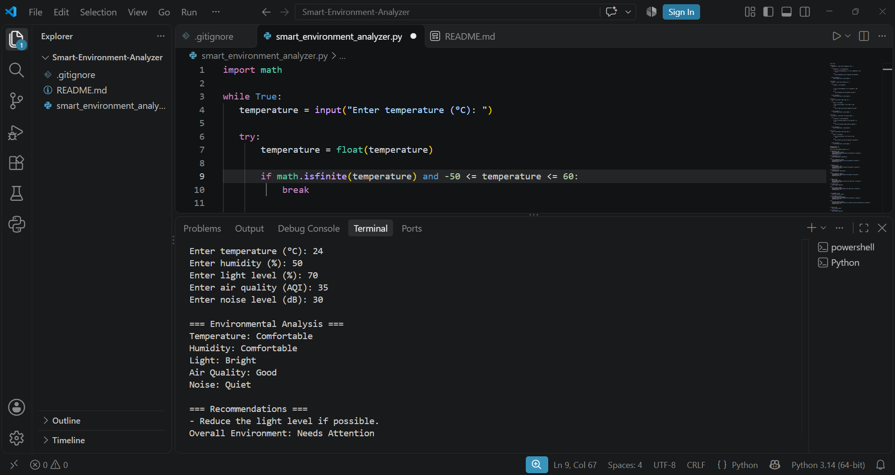

# 🌱 Smart Environment Analyzer

A beginner Python project exploring environmental measurements, conditional logic, input validation, and rule-based recommendations.

## 📌 About the Project

I created this project while learning Python because I wanted to apply the programming concepts I had studied to something practical.

The Smart Environment Analyzer is a command-line Python application that evaluates five environmental measurements:

- Temperature (°C)
- Humidity (%)
- Light level (%)
- Air Quality Index (AQI)
- Noise level (dB)

The user enters each measurement manually. The program validates the inputs, evaluates them using predefined conditions, and provides basic recommendations when a measurement falls outside its defined comfortable or acceptable range.

This project represents one of my early attempts to turn programming concepts into a practical application.

## 📸 Project Screenshot



## ⚙️ What Can It Do?

- Accept five environmental measurements from the user.
- Validate numerical inputs and reject invalid values.
- Check whether measurements fall within the permitted input ranges.
- Classify each measurement using conditional statements.
- Provide recommendations when a condition needs attention.
- Calculate an overall environmental status.
- Handle decimal values as well as whole numbers.

## 🔍 How Does It Work?

The program evaluates each measurement independently using predefined thresholds.

### 1. Measurement Classification

| Measurement | Classification | Condition |
|---|---|---|
| Temperature | Cold | Below 20°C |
| Temperature | Comfortable | 20–28°C |
| Temperature | Warm | Above 28°C |
| Humidity | Dry | Below 40% |
| Humidity | Comfortable | 40–60% |
| Humidity | Humid | Above 60% |
| Light | Low | 30% or below |
| Light | Moderate | Above 30% to 60% |
| Light | Bright | Above 60% |
| Air Quality | Good | AQI 50 or below |
| Air Quality | Moderate | AQI above 50 to 100 |
| Air Quality | Poor | AQI above 100 |
| Noise | Quiet | 40 dB or below |
| Noise | Moderate | Above 40 to 70 dB |
| Noise | Loud | Above 70 dB |

These are predefined rules used by this learning project. They are not intended to represent a scientifically validated environmental or health assessment.

### 2. Overall Environmental Status

The program counts how many measurements require attention and uses that count to determine the overall status.

- **Good:** No conditions require attention.
- **Needs Attention:** One or two conditions require attention.
- **Poor:** Three or more conditions require attention.

### 3. Recommendations

When a measurement falls outside its defined acceptable category, the program adds a corresponding suggestion to a list.

For example:
- Increase the temperature if possible.
- Reduce the humidity if possible.
- Improve ventilation if possible.
- Reduce the noise level if possible.

The recommendations depend on the values entered by the user.

## 🛡️ Input Validation

I included input validation to make the program more reliable when handling user entries.

| Measurement | Accepted input |
|---|---|
| Temperature | -50°C to 60°C |
| Humidity | 0% to 100% |
| Light level | 0% to 100% |
| Air Quality Index | Any finite, non-negative number |
| Noise level | 0 to 200 dB |

The program:
- Converts user input into numerical values using `float()`.
- Uses `try` and `except` to handle invalid numerical entries.
- Uses `math.isfinite()` to reject non-finite values.
- Repeats the input process until an acceptable value is entered.

## 🖥️ Example Run

Example input:

```text
Enter temperature (°C): 24
Enter humidity (%): 55
Enter light level (%): 79
Enter air quality (AQI): 35
Enter noise level (dB): 30
```

Example output:

```text
=== Environmental Analysis ===

Temperature: Comfortable
Humidity: Comfortable
Light: Bright
Air Quality: Good
Noise: Quiet

=== Recommendations ===
- Reduce the light level if possible.

Overall Environment: Needs Attention
```

## 🧠 Python Concepts I Used

While developing this project, I practised:

- Variables and user input
- `while` loops
- `if`, `elif`, and `else` statements
- `try` and `except` for error handling
- Lists and the `append()` method
- Converting input into numbers using `float()`
- Input validation and range checking
- Comparison and logical operators
- Python's built-in `math` module

## ▶️ How to Run It

### Requirements

- Python 3
- No external Python packages are required.

### Steps

1. Install Python 3 if it is not already installed.
2. Clone or download this repository.
3. Open a terminal in the project directory.
4. Run the following command:

```bash
python smart_environment_analyzer.py
```

5. Enter the requested environmental measurements and view the results.

## 📚 What I Learned

Building this project helped me practise Python fundamentals by combining loops, conditional statements, lists, input validation, and exception handling in one application.

I also learned the importance of testing different inputs, identifying errors, and improving my code when something did not work as expected.

Most importantly, this project helped me understand how basic programming logic can be applied to a practical problem.

## 🚀 Future Plans

As I continue learning Python, I would like to explore ways to expand this project, such as:

- Improving the analysis and recommendation system.
- Adding data storage for previous measurements.
- Exploring graphical representations of environmental data.
- Investigating possible integration with environmental sensors.
- Exploring more advanced data-analysis techniques.

These are future ideas, not features currently implemented in the application.

---

*An independent learning project built while developing my Python programming skills.*
